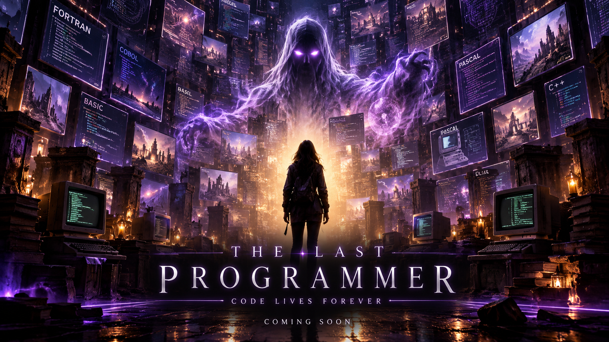

<div align="center">

<!-- ═══════════════════════════════════════════════════════════════ -->
<!--                        HERO BANNER                            -->
<!-- ═══════════════════════════════════════════════════════════════ -->



<br/>

<!-- Animated Typing SVG -->
<a href="https://git.io/typing-svg">
  
</a>

<br/>

<!-- Badges -->


<br/><br/>

*An ancient coding spirit has awakened inside your machine.*
*Ask it anything. Debug your code. Learn from the dead.*

<br/>

<!-- Animated wave separator -->


</div>

---

## 🌑 What Is This?

**The Last Programmer** is a spooky, fully-local AI coding companion that runs on your machine through [Ollama](https://ollama.com). No cloud. No API keys. No data leaves your computer.

Summon an ancient programming spirit — choose from three ghostly personalities — and let it help you write code, debug errors, and learn programming concepts through a hauntingly beautiful purple-black interface.

> *"I have wandered through FORTRAN halls and COBOL crypts. I have seen languages rise and fall. Ask me your questions, mortal."*
> — **The Last Programmer**

---

## ✨ Features

<table>
<tr>
<td width="50%">

### 🎭 Three Ghost Personalities
Switch between **Friendly Ghost** (Casper — warm, simple explanations), **Evil Ghost** (dramatic, creepy, but accurate), and **Ancient Programmer** (1985 retro expert).

</td>
<td width="50%">

### 🧠 Local AI, No Cloud
Powered by **Qwen 2.5 Coder 3B** through Ollama. Every prompt is processed on your hardware. Your conversations never leave your machine.

</td>
</tr>
<tr>
<td width="50%">

### 💬 Conversational Memory
The ghost remembers your recent messages for context-aware responses. Clear the conversation anytime with one click.

</td>
<td width="50%">

### 🔌 Works Offline
Once the model is downloaded and dependencies are installed, no internet connection is required. Code in the dark.

</td>
</tr>
<tr>
<td width="50%">

### 🎨 Haunted Interface
A custom purple-black Streamlit theme with glowing accents, rounded chat bubbles, and a spectral banner — designed to feel like a séance.

</td>
<td width="50%">

### 🔄 Swap Models Anytime
Not happy with the default model? Type any Ollama-compatible model name in the sidebar and the ghost inhabits a new mind.

</td>
</tr>
</table>

---

## 🛠️ Tech Stack

<div align="center">

| Layer | Technology | Role |
|:---:|:---:|:---:|
| 🐍 | **Python** | Core language |
| 🖥️ | **Streamlit** | Web UI framework |
| 🤖 | **Ollama** | Local model inference |
| 🧠 | **Qwen 2.5 Coder 3B** | Default AI model |

</div>

---

## 👻 Ghost Personalities

<div align="center">

| | Friendly Ghost 🤗 | Evil Ghost 😈 | Ancient Programmer 🖥️ |
|:---|:---:|:---:|:---:|
| **Vibe** | Warm & helpful | Dramatic & creepy | Retro & nostalgic |
| **Tone** | Light spooky jokes | Dark, theatrical phrasing | Old-school computer jargon |
| **Best For** | Beginners | Entertainment + learning | Legacy & systems programming |
| **Accuracy** | ✅ High | ✅ High (never sacrifices correctness) | ✅ High |

</div>

---

## 🚀 Quick Start

### Prerequisites

| Requirement | Details |
|:---|:---|
| **Python** | Version 3.10 or higher |
| **Ollama** | Download from [ollama.com](https://ollama.com) |
| **RAM** | Enough to run the AI model (~4 GB free recommended) |

<br/>

### ⚡ Step-by-step Setup

<details>
<summary><b>Step 1 — Install Ollama</b></summary>
<br/>

Download and install Ollama from **[ollama.com](https://ollama.com)**.

Available for macOS, Linux, and Windows.
</details>

<details>
<summary><b>Step 2 — Pull the AI Model</b></summary>
<br/>

Open your terminal and run:

```bash
ollama pull qwen2.5-coder:3b
```

> ☕ This downloads ~2 GB. Grab some coffee while the spirit materializes.
</details>

<details>
<summary><b>Step 3 — Install Python Dependencies</b></summary>
<br/>

Navigate to the project folder and run:

```bash
pip install -r requirements.txt
```
</details>

<details>
<summary><b>Step 4 — Summon the Ghost</b></summary>
<br/>

```bash
streamlit run app.py
```

The app opens automatically in your browser. 🌙

</details>

---

## 🔒 Privacy & Open Innovation

<div align="center">

```
┌─────────────────────────────────────────────┐
│           YOUR COMPUTER                     │
│                                             │
│   ┌───────────┐       ┌──────────────┐      │
│   │ Streamlit │ ───▶  │   Ollama     │      │
│   │   App     │ ◀───  │  (Local AI)  │      │
│   └───────────┘       └──────────────┘      │
│                                             │
│   🔒 No data leaves this box.              │
└─────────────────────────────────────────────┘
```

</div>

| Principle | Description |
|:---|:---|
| 🏠 **Local AI** | All prompts processed on your machine via Ollama |
| 🔐 **Privacy** | Chat messages are never sent to external servers |
| 📡 **Offline** | Works without internet after initial setup |
| 🔄 **Flexible** | Swap to any Ollama-compatible model |
| 💸 **Free** | No paid API keys required — ever |

---

## 🎃 Challenge Theme

> Built for the **"Ghost in the Machine"** challenge.

This project brings an ancient programming spirit to life using open-weight AI. It combines spooky storytelling with practical coding assistance — proving that AI can be local, private, creative, and genuinely useful.

---

<div align="center">

<!-- Animated wave separator -->


<br/>


<br/><br/>

**⭐ Star this repo if the ghost helped you.**

*Made with 🕯️ and open-weight AI.*

</div>
